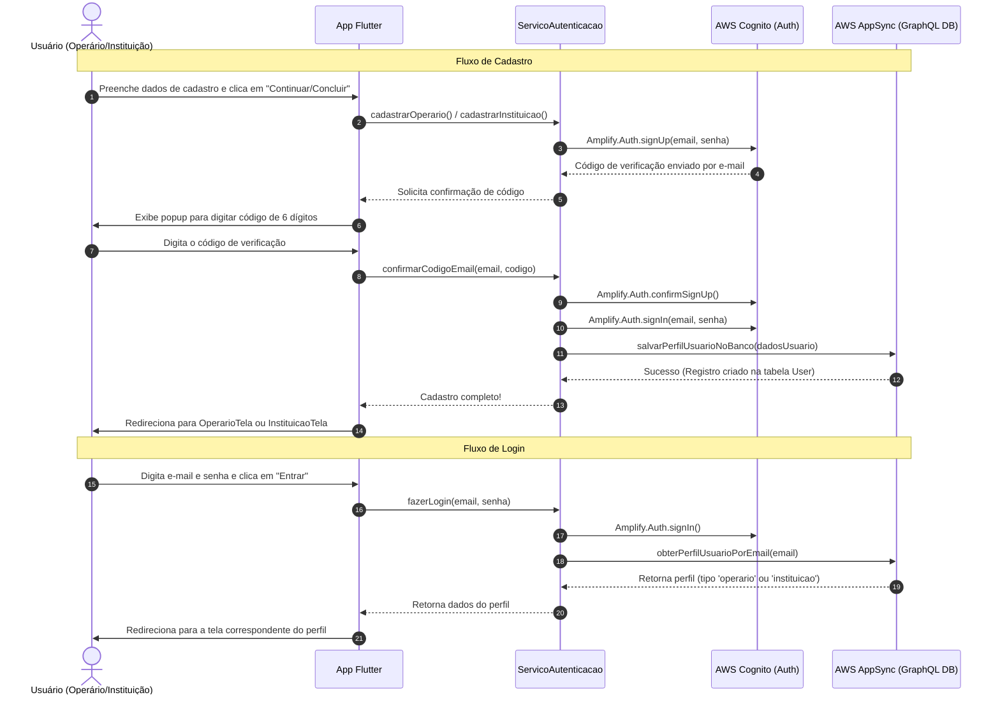

# Plano de Integração do Frontend com AWS Amplify (Cognito & AppSync)

Integração dos fluxos de login, cadastro, confirmação de código por e-mail e persistência de dados de perfil no banco GraphQL/AppSync da AWS para ambos os papéis solidários (**Operário** e **Instituição**).

> [!NOTE]
> Conforme solicitado, **todos os nomes de funções, variáveis e arquivos criados por nós serão escritos em português** (ex.: `servicoAutenticacao`, `fazerLogin`, `cadastrarOperario`, `confirmarCodigoEmail`), facilitando a diferenciação do código próprio versus as classes internas do Flutter/Amplify.

---

## Estrutura da Solução e Fluxo

---

## Usuário em Revisão / Ações do Usuário

> [!IMPORTANT]
> **Atenção quanto às senhas e verificação de e-mail**:
> - A política de senha do seu Cognito exige no mínimo 8 caracteres com letras maiúsculas, minúsculas, números e símbolos (ex.: `Senha123!`).
> - Ao cadastrar, um e-mail com um código numérico de 6 dígitos será enviado pela AWS para o e-mail informado. Criaremos uma caixa de diálogo no app para inserção desse código.

---

## Proposta de Alterações

### Dependências e Configurações

#### [MODIFY] [pubspec.yaml](file:///C:/Users/aliru/Desktop/maos_solidarias/pubspec.yaml)
- Adicionar a dependência `amplify_api: ^2.11.0` para comunicação GraphQL com a tabela `User` do AppSync.
- Incluir o arquivo `amplify_outputs.json` na seção `assets` do Flutter para que o app consiga lê-lo na inicialização.

---

### Serviço de Autenticação e Banco de Dados

#### [NEW] [servico_autenticacao.dart](file:///C:/Users/aliru/Desktop/maos_solidarias/lib/services/servico_autenticacao.dart)
Criar a classe singleton `ServicoAutenticacao` responsável por isolar todas as chamadas à AWS:
- `inicializarAmplify()`: Lê o `amplify_outputs.json` dos assets e executa `Amplify.configure()`.
- `cadastrarOperario(...)`: Chama `Amplify.Auth.signUp` com o e-mail e senha do operário.
- `cadastrarInstituicao(...)`: Chama `Amplify.Auth.signUp` com o e-mail e senha da instituição.
- `confirmarCodigoEmail({required String email, required String codigoConfirmacao})`: Executa `Amplify.Auth.confirmSignUp`.
- `fazerLogin({required String email, required String senha})`: Executa `Amplify.Auth.signIn`.
- `salvarPerfilUsuarioNoBanco(...)`: Executa uma mutação GraphQL (`createUser`) via `Amplify.API.mutate` com todos os campos da tabela `User`.
- `obterPerfilUsuarioPorEmail(String email)`: Executa uma consulta GraphQL (`listUsers`) para recuperar se o usuário logado é `'operario'` ou `'instituicao'` e popular as variáveis de estado do app.
- `fazerLogout()`: Executa `Amplify.Auth.signOut()`.
- `verificarSessaoAtiva()`: Verifica se há um usuário já autenticado ao abrir o aplicativo.

---

### Componentes e Diálogos Visuais

#### [NEW] [dialogo_confirmacao_codigo.dart](file:///C:/Users/aliru/Desktop/maos_solidarias/lib/widgets/dialogo_confirmacao_codigo.dart)
- Popup intuitivo para solicitar os 6 dígitos do código de verificação enviado pela AWS ao e-mail cadastrado, permitindo reenvio se necessário (`reenviarCodigoConfirmacao`).

---

### Telas de Autenticação e Inicialização

#### [MODIFY] [main.dart](file:///C:/Users/aliru/Desktop/maos_solidarias/lib/main.dart)
- Inicializar o `ServicoAutenticacao` no método `main()` antes de subir a interface.

#### [MODIFY] [tela_autenticacao_operario.dart](file:///C:/Users/aliru/Desktop/maos_solidarias/lib/screens/auth/tela_autenticacao_operario.dart)
- Conectar formulário de Login ao método `fazerLogin` do `ServicoAutenticacao`.
- Conectar formulário de Cadastro ao `cadastrarOperario`, exibindo o `DialogoConfirmacaoCodigo` e registrando o perfil no AppSync.

#### [MODIFY] [tela_autenticacao_instituicao.dart](file:///C:/Users/aliru/Desktop/maos_solidarias/lib/screens/auth/tela_autenticacao_instituicao.dart)
- Conectar formulário de Login ao método `fazerLogin` do `ServicoAutenticacao`.
- Conectar formulário de Cadastro ao `cadastrarInstituicao`, exibindo o `DialogoConfirmacaoCodigo` e registrando o perfil no AppSync.

#### [MODIFY] [tela_perfil.dart](file:///C:/Users/aliru/Desktop/maos_solidarias/lib/screens/shared/tela_perfil.dart)
- Conectar o botão "Sair" ao método `fazerLogout` do `ServicoAutenticacao`.

---

## Plano de Verificação

### Testes Manuais
1. **Verificação da Inicialização**: Garantir que o aplicativo inicializa sem erros ao carregar `amplify_outputs.json`.
2. **Cadastro de Operário**:
   - Cadastrar um novo operário com e-mail real.
   - Verificar recebimento do código por e-mail e inserção no diálogo.
   - Confirmar o redirecionamento automático para a `OperarioTela`.
3. **Cadastro de Instituição**:
   - Cadastrar uma nova instituição.
   - Verificar confirmação por código e salvamento na tabela `User`.
   - Confirmar o redirecionamento automático para a `InstituicaoTela`.
4. **Login e Verificação de Sessão**:
   - Deslogar e fazer login com as credenciais criadas.
   - Verificar se o app reconhece corretamente o tipo de perfil do usuário.
